# Taller Segundo Corte – Consola de mandos ESP32 para robots simulados (real-to-sim)

**Universidad Militar Nueva Granada – Ingeniería Mecatrónica**<br>
**Asignatura:** Micros y Laboratorio<br>
**Autor:** Faber Alexander Rodriguez Hernandez<br>
**Código:** 7004488

Se construyó **una sola consola de mandos física** con un **ESP32**, 3 potenciómetros y 5 pulsadores. La consola envía su estado por **UART (USB-Serial)** a Python, y con ella se controlan en tiempo real tres robots simulados en **PyBullet**. Los robots vienen de los repositorios indicados en el taller:

| Inciso | Robot y escena | Repositorio de origen | Qué hace la consola |
|---|---|---|---|
| **(a)** | Enjambre de 6 drones Crazyflie | [utiasDSL/gym-pybullet-drones](https://github.com/utiasDSL/gym-pybullet-drones) | Despegar, aterrizar y volar en formación entre los puntos **A → B → C**, con altura, velocidad y tamaño de la formación ajustables |
| **(b)** | Robot Baxter con dos brazos y pinzas | [erwincoumans/pybullet_robots](https://github.com/erwincoumans/pybullet_robots) (`baxter_ik_demo.py`) | Mover cada pinza en X, Y, Z con **cinemática inversa**, abrir y cerrar la pinza, y **coger bloques y dejarlos en una bandeja** (manual, en espejo o con una rutina automática) |
| **(c)** | Humanoide Atlas de pie en el laboratorio "botlab" | [erwincoumans/pybullet_robots](https://github.com/erwincoumans/pybullet_robots) (`atlas.py`) | Mover **18 grados de libertad** (torso, cabeza, brazos y piernas) de forma fluida mientras el robot **se mantiene en equilibrio** sobre sus pies, grabar y reproducir poses, y lanzar demostraciones |

El **firmware es el mismo para los tres incisos**: el ESP32 solo mide y envía. Cada script de Python decide qué significa cada potenciómetro y cada pulsador.

<!-- RESUMEN_RESULTADOS -->

---

## Contenido

1. [Arquitectura del sistema](#1-arquitectura-del-sistema)
2. [Inciso (a): enjambre de drones A → B → C](#2-inciso-a-enjambre-de-drones-a--b--c)
3. [Inciso (b): Baxter con pinza (pick-and-place)](#3-inciso-b-baxter-con-pinza-pick-and-place)
4. [Inciso (c): movilidad del humanoide Atlas](#4-inciso-c-movilidad-del-humanoide-atlas)
5. [Validación de la comunicación en tiempo real](#5-validación-de-la-comunicación-en-tiempo-real)
6. [Materiales y software](#6-materiales-y-software)
7. [Paso a paso para replicarlo](#7-paso-a-paso-para-replicarlo)
8. [Explicación del código](#8-explicación-del-código)
9. [Estructura del repositorio](#9-estructura-del-repositorio)
10. [Problemas comunes y soluciones](#10-problemas-comunes-y-soluciones)
11. [Conclusiones](#11-conclusiones)
12. [Referencias](#12-referencias)

---

## 1. Arquitectura del sistema

### 1.1 Diagrama de bloques

El sistema está dividido en dos partes. El **ESP32** hace el trabajo de tiempo real con el hardware: muestrea los potenciómetros a una frecuencia fija, filtra el ruido, elimina los rebotes de los pulsadores y envía todo en una trama con número de secuencia y checksum. El **PC** hace el trabajo pesado: la física, el control de cada robot y la visualización 3D. Entre los dos hay un módulo común (`comun/consola.py`) que valida las tramas y ofrece la misma interfaz a los tres incisos.

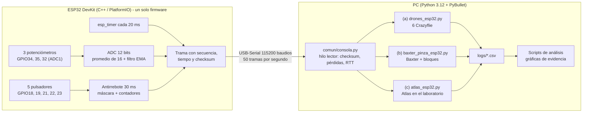

### 1.2 Diagrama de conexiones

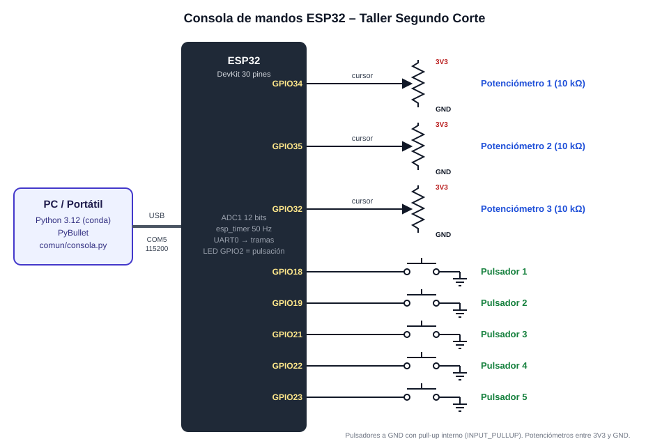

| Componente | Pin del ESP32 | Conexión |
|---|---|---|
| Potenciómetro 1 (10 kΩ) | GPIO34 | Extremos a **3V3** y **GND**, cursor (pata del medio) al pin |
| Potenciómetro 2 (10 kΩ) | GPIO35 | Igual |
| Potenciómetro 3 (10 kΩ) | GPIO32 | Igual |
| Pulsadores 1 a 5 (2 patas) | GPIO18, 19, 21, 22, 23 | Una pata al pin y la otra a **GND**, sin resistencia (pull-up interno) |
| LED de la placa | GPIO2 | Destella 60 ms cada vez que se presiona un pulsador |
| ESP32 → PC | USB | Cable micro-USB **de datos** (COM5 en este equipo) |

- Los potenciómetros van a **3V3 y no a 5 V**, porque el ADC del ESP32 solo mide hasta ~3.3 V.
- Se usan pines del **ADC1** (GPIO32 a 39). El ADC2 se bloquea cuando se usa el WiFi, y así el diseño queda listo para una versión inalámbrica.
- Los pulsadores usan `INPUT_PULLUP`: suelto se lee `HIGH` y presionado `LOW`, sin resistencias externas.

### 1.3 Protocolo de comunicación

El ESP32 envía **50 tramas por segundo** con el estado completo de la consola:

```
$<seq>,<t_ms>,<pot1>,<pot2>,<pot3>,<botones>,<c1>,<c2>,<c3>,<c4>,<c5>*<CS>\r\n
```

| Campo | Ejemplo | Para qué sirve |
|---|---|---|
| `$` | `$` | Marca el inicio de la trama |
| `seq` | `18557` | Contador de 0 a 65535. Un salto indica tramas perdidas |
| `t_ms` | `371185` | `millis()` del ESP32 al tomar la muestra. Mide el periodo real en el origen |
| `pot1..pot3` | `2559,2202,270` | Lecturas filtradas del ADC (0 a 4095) |
| `botones` | `0` | Máscara de bits de los pulsadores **presionados en este instante** (bit 0 = pulsador 1). Sirve para las pulsaciones largas |
| `c1..c5` | `2,1,0,3,1` | **Contador de pulsaciones** de cada pulsador |
| `*CS` | `*0A` | XOR de todos los caracteres entre `$` y `*`, en hexadecimal |

- **Pulsaciones por contador, no por estado.** El PC compara cada contador con el de la trama anterior. Si una trama se pierde, la siguiente ya trae el contador aumentado, así que **ninguna pulsación se pierde**. La máscara `botones` se usa solo para saber si un pulsador se está manteniendo (por ejemplo, "mantener 1.5 s para borrar").
- **Ancho de banda.** La trama `$18557,371185,2559,2202,270,0,2,1,0,3,1*0A` ocupa 44 bytes con el `\r\n`. A 50 Hz y 10 bits por byte son 44 × 10 × 50 = **22 000 bit/s**, el **19 %** de la capacidad a 115 200 baudios.
- **Latencia (RTT).** Cada segundo el PC envía `P<n>` y el ESP32 responde de inmediato `#PONG,<n>`. La diferencia de tiempo es la latencia de ida y vuelta del enlace, medida sin necesidad de sincronizar relojes.

### 1.4 Recorrido de un dato, del potenciómetro al robot

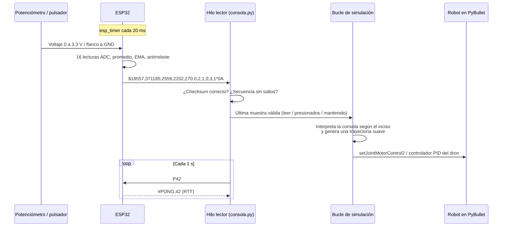

### 1.5 Estructura del software

Los tres incisos comparten la misma lectura de la consola, el mismo indicador en pantalla y el mismo modo de prueba sin hardware:

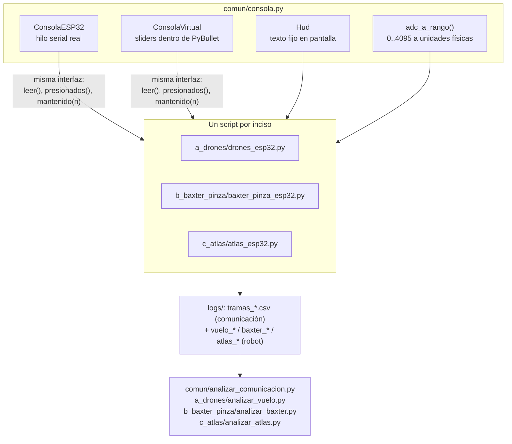

Con `--sin-serial`, cualquiera de los tres scripts usa `ConsolaVirtual`: los 3 potenciómetros y los 5 pulsadores aparecen como controles dentro de la ventana de PyBullet. Así se puede probar cada robot sin el ESP32.

---

## 2. Inciso (a): enjambre de drones A → B → C

### 2.1 Qué hace

Seis cuadricópteros **Crazyflie 2.X** de `gym-pybullet-drones` vuelan en **formación hexagonal** entre tres puntos marcados en el piso: **A** (rojo), **B** (azul) y **C** (verde). Toda la misión se manda desde la consola:

| Control | Función | Rango |
|---|---|---|
| Potenciómetro 1 | Altura de vuelo | 0.3 a 1.5 m |
| Potenciómetro 2 | Velocidad de crucero | 0.1 a 1.0 m/s |
| Potenciómetro 3 | Radio de la formación | 0.25 a 0.7 m |
| Pulsador 1 / 2 / 3 | Ir al punto **A** / **B** / **C** (si está en tierra, despega primero) | – |
| Pulsador 4 | Despegar / aterrizar | – |
| Pulsador 5 | Ruta automática **A → B → C** con 2 s de espera en cada punto (otra pulsación la cancela) | – |

En pantalla se ven el estado de la misión, el destino, los valores de los potenciómetros, la posición del centro de la formación con su error, el estado de la comunicación y las estelas de cada dron.

### 2.2 Video de evidencia

VIDEO_INCISO_A

### 2.3 Captura

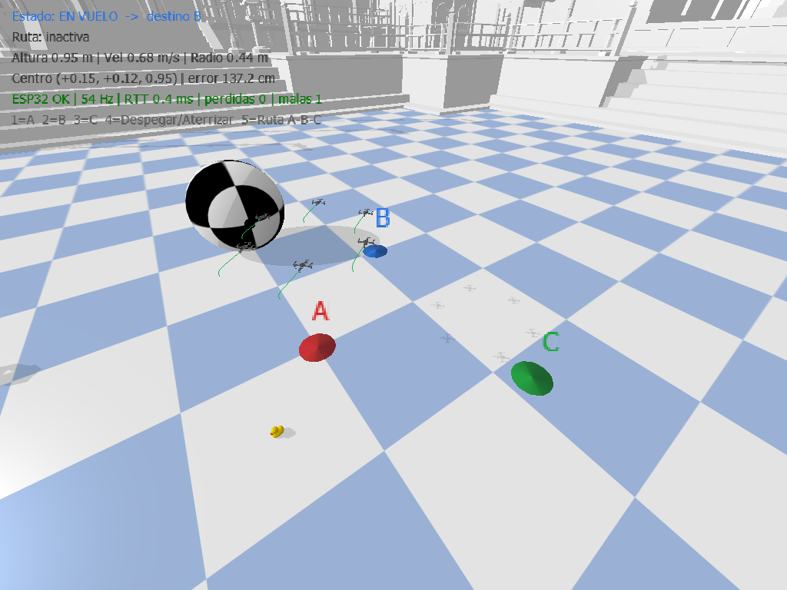

*Formación de 6 drones volando de A hacia B; las líneas verdes son las estelas de cada dron. Arriba, el indicador con el estado de la misión, los valores de los potenciómetros y el estado de la comunicación.*

### 2.4 Máquina de estados de la misión

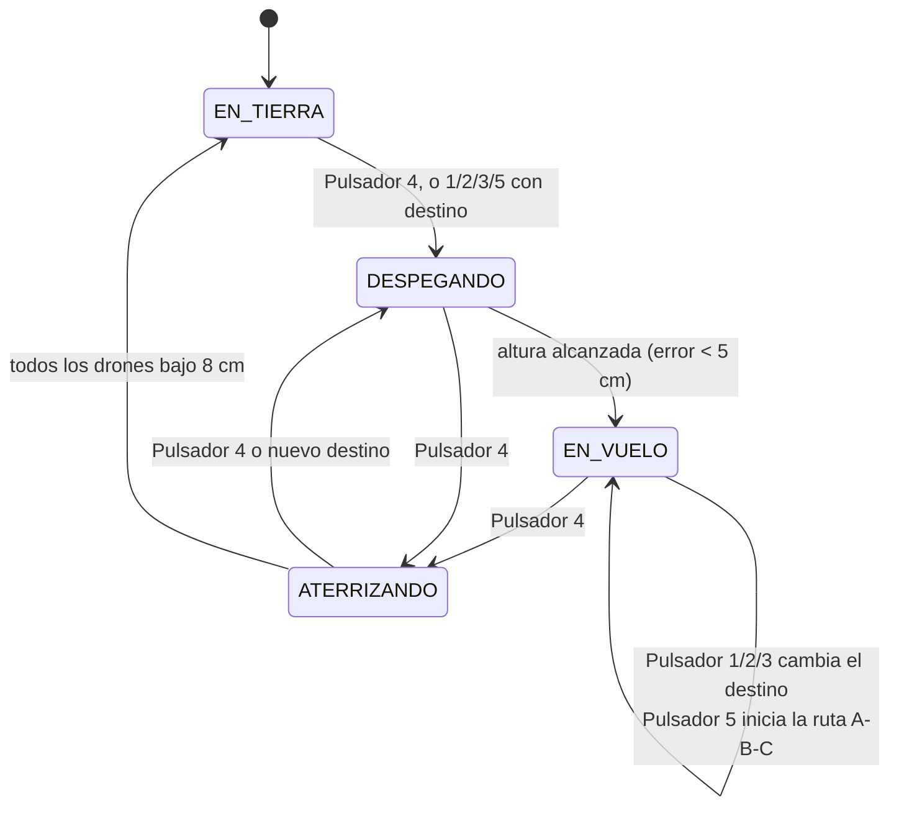

### 2.5 Análisis

**Control en dos niveles.** La consola no mueve los motores directamente. Genera una **referencia suave** para el centro de la formación, y cada dron tiene su propio controlador **PID en cascada** (`DSLPIDControl`: lazo de posición que genera el empuje y la actitud deseados, y lazo de actitud que genera las RPM de los 4 motores). La física corre a 240 Hz y el control a 48 Hz.

**Perfil trapezoidal de velocidad.** Si la referencia saltara directamente al punto B, los PID pedirían una aceleración enorme, los drones se inclinarían mucho y la formación se desarmaría. Por eso la referencia avanza con un perfil trapezoidal: acelera a 0.4 m/s², viaja a la velocidad del potenciómetro 2 y frena a tiempo para detenerse justo en el punto:

$$v_{k+1} = \min\left(v_k + a_{max}\,\Delta t,\;\; v_{crucero},\;\; \sqrt{2\,a_{max}\,d_{restante}}\right)$$

El término $\sqrt{2\,a\,d}$ es la velocidad máxima desde la que todavía se puede frenar en la distancia que falta. Además, la velocidad de la referencia se pasa al PID como **prealimentación** (`target_vel`), así los drones no se quedan atrás de la referencia durante el crucero.

| Tramo | Distancia | Tiempo teórico a 0.5 m/s y 0.4 m/s² |
|---|---|---|
| A → B | 1.56 m | 2 × (0.5 / 0.4) + (1.56 − 0.625) / 0.5 = **4.4 s** |
| B → C | 2.20 m | **5.7 s** |
| C → A | 1.70 m | **4.6 s** |

**Formación.** Cada dron tiene un desfase fijo respecto al centro, repartido en un hexágono de radio $r$:

$$\vec{p}_j = \vec{c} + r\,\big(\cos(2\pi j/6),\; \sin(2\pi j/6)\big), \quad j = 0 \dots 5$$

Al girar el potenciómetro 3, el radio no salta: cambia a 0.2 m/s como máximo, igual que la altura (0.4 m/s), para que los drones no choquen ni pierdan estabilidad.

**Llegada.** Se considera que la formación llegó cuando la referencia ya está en el punto y el centro real de los 6 drones está a **menos de 3 cm** de él. En la ruta A → B → C, la formación espera 2 s en cada punto antes de seguir.

### 2.6 Resultados

<!-- RESULTADOS_A -->

---

## 3. Inciso (b): Baxter con pinza (pick-and-place)

### 3.1 Qué hace

El robot **Baxter** (`toms_baxter.urdf`, el mismo de `baxter_ik_demo.py`) está frente a una mesa con dos bloques (rojo y azul) y una bandeja verde. Con la consola se mueve la **pinza** de cada brazo en el espacio, y el programa calcula por **cinemática inversa** los ángulos de las 7 articulaciones del brazo. Con la pinza se cogen los bloques y se dejan en la bandeja.

| Control | Función |
|---|---|
| Potenciómetro 1 | **X**: acercar o alejar la pinza del robot (0.40 a 0.80 m) |
| Potenciómetro 2 | **Y**: mover la pinza a la derecha o a la izquierda |
| Potenciómetro 3 | **Z**: altura de la pinza sobre la mesa (1.5 a 33 cm) |
| Pulsador 1 | Cambiar el brazo activo (derecho / izquierdo) |
| Pulsador 2 | Abrir / cerrar la pinza del brazo activo |
| Pulsador 3 | **Modo espejo**: los dos brazos a la vez, el izquierdo copia al derecho |
| Pulsador 4 | Volver a la posición inicial (mantener 1.5 s: reiniciar los bloques) |
| Pulsador 5 | **Rutina automática**: llevar los dos bloques a la bandeja |

Una esfera de color muestra a dónde apunta la consola, y en pantalla se ven el objetivo, el error de seguimiento, el estado de cada pinza y cuántos bloques hay en la bandeja.

### 3.2 Video de evidencia

VIDEO_INCISO_B

### 3.3 Captura

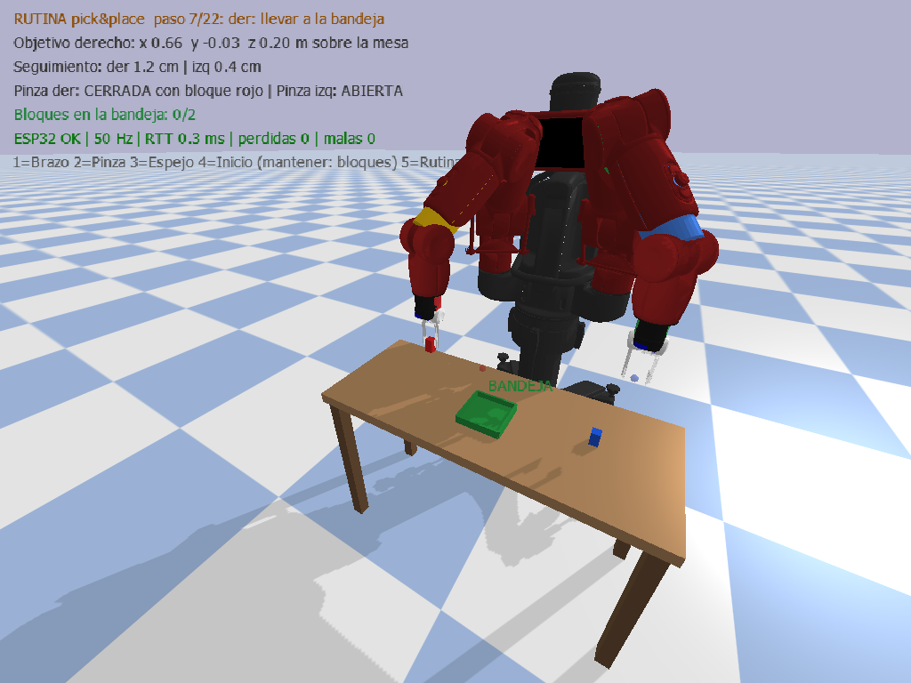

*Rutina automática, paso 7 de 22: la pinza derecha lleva el bloque rojo a la bandeja.*

### 3.4 Del potenciómetro a las articulaciones

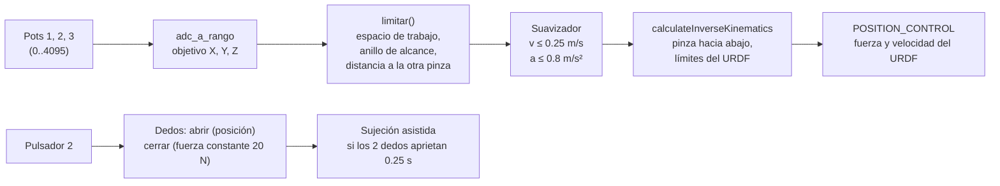

### 3.5 Análisis

**Posicionamiento real, no teletransporte.** En `baxter_ik_demo.py` el resultado de la cinemática inversa se aplica con `resetJointState`, es decir, las articulaciones saltan a su posición. Aquí se usan los **motores** (`POSITION_CONTROL`) con la fuerza y la velocidad máximas de cada articulación del URDF (50 N·m y 1.5 rad/s en hombro y codo, 15 N·m y 4 rad/s en la muñeca). El brazo tiene inercia, gravedad y límites, como el robot real.

**Movimiento fluido.** Si el objetivo de la cinemática inversa siguiera directamente al potenciómetro, un giro rápido de la perilla haría que el brazo pegara un tirón. El `Suavizador` hace que el objetivo cartesiano avance con **velocidad y aceleración limitadas** (0.25 m/s y 0.8 m/s²). En cada paso calcula la velocidad deseada hacia el objetivo, frenando a tiempo:

$$v_{deseada} = \min\left(v_{max},\; \sqrt{2\,a_{max}\,d},\; d/\Delta t\right), \qquad |\Delta v| \le a_{max}\,\Delta t$$

**Cinemática inversa con los límites reales.** `calculateInverseKinematics` usa mínimos cuadrados amortiguados (*Damped Least Squares*) con las **posiciones límite de cada articulación leídas del URDF** (el ejemplo original usaba ±2 rad para todas). También se le pide una orientación fija, con la pinza apuntando hacia abajo, y una pose de reposo que evita soluciones con el codo en posiciones raras.

**Espacio de trabajo.** No todo punto de la mesa es alcanzable con la pinza vertical. Se midió con la propia cinemática inversa que el error es menor de 1 cm cuando la pinza está entre **0.44 y 0.72 m del hombro** (en horizontal). La función `limitar()` proyecta el objetivo dentro de ese anillo, dentro de la altura permitida y a más de 14 cm de la otra pinza, así el robot nunca intenta una posición imposible ni choca los brazos.

**Captura suave de los potenciómetros.** Al cambiar de brazo o terminar la rutina, los potenciómetros están en otra posición. Para que el brazo no salte, el control solo se "toma" cuando un potenciómetro se mueve más de **90 cuentas** desde donde estaba.

**Agarre.** Los dedos se abren con control de posición (2.1 cm cada uno) y se cierran con **control de velocidad y fuerza limitada** (20 N), así aprietan el bloque con fuerza constante en vez de intentar llegar a una posición. Los bloques miden 3 × 3 × 5 cm y pesan 50 g.

**Sujeción asistida.** El contacto entre dos dedos rígidos y un bloque rígido en Bullet deja que el bloque gire o se deslice al mover el brazo rápido (en el robot real eso lo evita el caucho de los dedos). Por eso, cuando la pinza está cerrada y **los dos dedos llevan 0.25 s tocando el mismo bloque**, se crea una unión fija de fuerza limitada (40 N) entre la pinza y el bloque, igual que el plugin *grasp fix* de Gazebo. Al abrir la pinza, la unión desaparece y el bloque cae. La unión solo se crea si hay un agarre físico real: si la pinza se cierra en el aire o sobre un solo lado del bloque, no pasa nada.

**Rutina automática de pick-and-place.** Para cada bloque que no esté en la bandeja, genera 11 pasos: abrir, ir sobre el bloque, bajar, cerrar, levantar, **verificar el agarre**, llevar a la bandeja, bajar, soltar, subir y volver al inicio. Si la verificación falla, se replanifica con la posición actual del bloque (hasta 3 intentos). Como el bloque es simétrico cada 90°, hay varios giros de muñeca que sirven para cogerlo: el programa prueba cada uno con la cinemática inversa en todos los puntos de la maniobra y escoge el alcanzable que menos gira la muñeca.

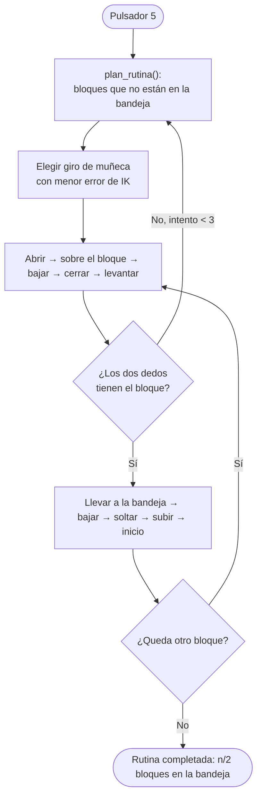

### 3.6 Resultados

<!-- RESULTADOS_B -->

---

## 4. Inciso (c): movilidad del humanoide Atlas

### 4.1 Qué hace

El humanoide **Atlas** de Boston Dynamics (`atlas_v4_with_multisense.urdf`, 182 kg y 30 articulaciones) está de pie sobre una caja dentro del laboratorio **botlab**, igual que en `atlas.py` del repositorio. A diferencia del Baxter, el Atlas **no está anclado**: se sostiene sobre sus pies con la física de PyBullet, así que cada movimiento de los brazos, el torso o las piernas cambia su equilibrio.

La consola maneja **18 grados de libertad** en 4 grupos. Cada grupo usa los 3 potenciómetros:

| Grupo (pulsador 1) | Potenciómetro 1 | Potenciómetro 2 | Potenciómetro 3 |
|---|---|---|---|
| 1. Torso y cabeza | Giro del torso (±34°) | Inclinación adelante (−11° a 26°) | Cabeza (−34° a 57°) |
| 2. Hombro | Hombro adelante `shz` | Hombro arriba/abajo `shx` | Giro del brazo `ely` |
| 3. Codo y muñeca | Codo `elx` | Giro de muñeca `wry` | Flexión de muñeca `wrx` |
| 4. Piernas | Sentadilla | Balanceo lateral | Inclinación lateral del torso |

| Pulsador | Función |
|---|---|
| 1 | Siguiente grupo (los eslabones del grupo se resaltan en amarillo) |
| 2 | Brazo: **derecho → izquierdo → ambos en espejo** |
| 3 | Grabar la pose actual (hasta 12). Mantener 1.5 s: borrar todas |
| 4 | Reproducir en bucle las poses grabadas / detener |
| 5 | Siguiente demostración: **saludo, sentadilla, giro de torso, brazos abajo, en cruz** |
| Tecla R | Reponer el Atlas de pie sobre la caja |

En pantalla se ven el grupo y el brazo activos, el ángulo de cada potenciómetro con una barra de su rango, el **estado del equilibrio** (margen en cm e inclinación), el número de poses grabadas y de caídas. Sobre la caja se dibujan el contorno de los pies (azul) y un disco que marca el **centro de masa** proyectado, que cambia de verde a naranja y a rojo según qué tan cerca está de caerse.

### 4.2 Video de evidencia

VIDEO_INCISO_C

### 4.3 Captura

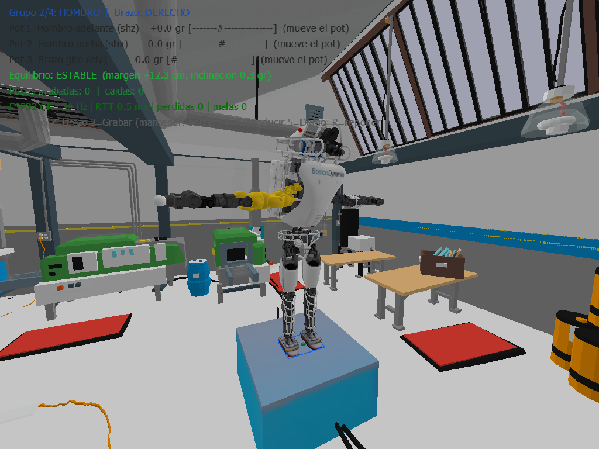

*El grupo 2 (hombro) del brazo derecho está resaltado en amarillo. Bajo los pies se ven el contorno de apoyo y el disco verde del centro de masa.*

### 4.4 Lazo de control

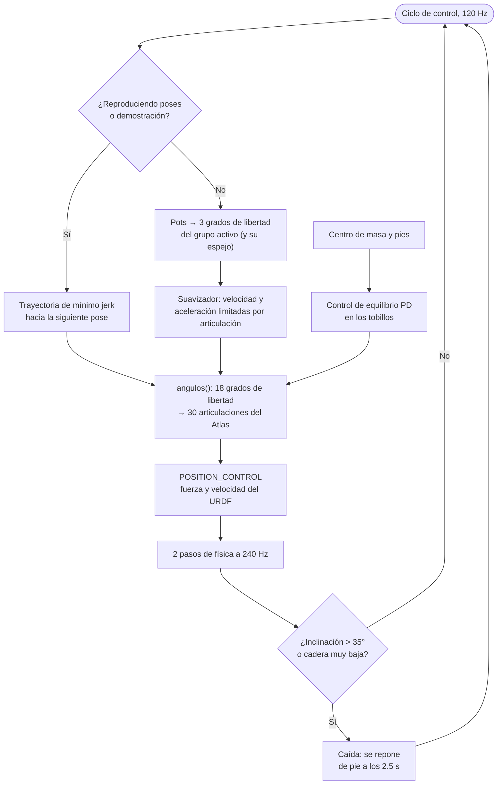

### 4.5 Análisis

**De 18 grados de libertad a 30 motores.** Los brazos, el torso y la cabeza van directo a su articulación (16 grados de libertad). Las piernas son distintas: mover una sola articulación de la pierna tumba al robot. Por eso la sentadilla y el balanceo son **movimientos coordinados** de varias articulaciones:

- **Sentadilla** de valor $s$: cadera $-s$, rodilla $2s$ y tobillo $-s$ en las dos piernas. Como el muslo y la pierna del Atlas miden casi lo mismo, la cadera baja en vertical, **los pies quedan planos** y el torso sigue derecho.
- **Balanceo lateral** de valor $b$: cadera $+b$ y tobillo $-b$ (un paralelogramo). La cadera se desplaza hacia un lado sin inclinar los pies.
- Las 4 articulaciones restantes (giro de cadera y `wry2` de cada lado) se mantienen en 0.

**Control de equilibrio (estrategia de tobillo).** Es la misma estrategia que usa una persona de pie: corregir con los tobillos. En cada ciclo se calcula el **centro de masa** del robot (promedio de la posición de sus 31 eslabones pesado por su masa) y el **polígono de apoyo** (el rectángulo que cubre los dos pies). El error se lleva a los ejes del robot y un controlador PD lo corrige con los tobillos:

$$\vec{e} = R(\psi)\,(\vec{p}_{CM} - \vec{p}_{pies}), \qquad \theta_{tobillo} = \mathrm{sat}_{\pm 0.35}\!\left(K_p\,\vec{e} + K_d\,\dot{\vec{e}}\right)$$

con $K_p = (1.5,\,-1.0)$ y $K_d = (0.3,\,-0.2)$ para (adelante-atrás, lateral). El signo negativo del eje lateral se debe a la orientación del eje `akx` en el URDF: con signo positivo el robot se caía de inmediato. La corrección se suma a la sentadilla y al balanceo que pide la consola.

**Margen de estabilidad.** Es la distancia del centro de masa al borde más cercano del polígono de apoyo. Con más de **3 cm** el robot está **ESTABLE**, entre 0 y 3 cm está **AL LÍMITE**, y si es negativo el centro de masa salió de los pies y el robot se va a caer.

**Caída y reposición.** Si la inclinación del torso supera 35° o la cadera baja demasiado, se registra una caída, se detiene cualquier reproducción y a los **2.5 s** el Atlas vuelve a quedar de pie sobre la caja.

**Movimiento fluido.** En modo manual cada grado de libertad pasa por un `Suavizador` con velocidad y aceleración limitadas (brazos 1.2 rad/s y 3 rad/s², torso 0.6 rad/s y 1.5 rad/s², sentadilla más lenta para no desequilibrar). Para las poses grabadas y las demostraciones se usa una **trayectoria de mínimo jerk**:

$$q(t) = q_0 + \Delta q\,(10\tau^3 - 15\tau^4 + 6\tau^5), \qquad \tau = t/T$$

Todas las articulaciones salen y llegan **al mismo tiempo**, con velocidad y aceleración cero en los extremos, que es como se mueve un brazo humano. La duración $T$ se escoge para respetar los límites: la velocidad pico de este perfil es $1.875\,\Delta q/T$ y la aceleración pico $5.77\,\Delta q/T^2$, así que

$$T = \max\left(0.5\text{ s},\;\; \frac{1.875\,|\Delta q|}{v_{max}},\;\; \sqrt{\frac{5.77\,|\Delta q|}{a_{max}}}\right)$$

**Modo espejo.** Con "ambos", el brazo izquierdo copia al derecho cambiando el signo de `shz`, `shx`, `elx` y `wrx` (los ejes que en el URDF están reflejados entre un lado y el otro).

### 4.6 Resultados

<!-- RESULTADOS_C -->

---

## 5. Validación de la comunicación en tiempo real

Cada vez que se usa la consola real, `ConsolaESP32` guarda **una fila por cada trama recibida** en `logs/tramas_*.csv`, con el número de secuencia, el tiempo del ESP32, el tiempo de llegada al PC, los contadores de tramas buenas, malas y perdidas, y el RTT. `comun/analizar_comunicacion.py` calcula con ese registro:

- la frecuencia de recepción y el **periodo real de muestreo del ESP32** (Δt<sub>ESP32</sub> / Δseq);
- el intervalo de llegada al PC y su **jitter**;
- las tramas **perdidas** (saltos en la secuencia) y **con error** (checksum inválido);
- la **latencia de ida y vuelta (RTT)**.

<!-- RESULTADOS_COMUNICACION -->

---

## 6. Materiales y software

**Hardware**

- ESP32 DevKit V1 (30 pines)
- 3 potenciómetros de 10 kΩ
- 5 pulsadores de 2 patas
- Protoboard, cables de conexión y cable micro-USB de datos

**Software**

| Herramienta | Versión | Uso |
|---|---|---|
| Windows | 11 | Sistema operativo |
| VS Code + PlatformIO | – | Compilar y cargar el firmware |
| Framework Arduino para ESP32 | plataforma `espressif32` | Firmware en C++ |
| Miniconda | – | Entorno de Python con PyBullet ya compilado |
| Python | 3.12 (entorno `taller`) | Scripts de control y análisis |
| pybullet | conda-forge | Simulación física |
| gym-pybullet-drones | rama `main` | Modelos y controladores de los drones (inciso a) |
| pyserial, numpy, matplotlib | conda-forge | Comunicación, cálculo y gráficas |

**Modelos 3D** (incluidos en `modelos/`, tomados de [erwincoumans/pybullet_robots](https://github.com/erwincoumans/pybullet_robots)):

| Carpeta | Contenido | Inciso |
|---|---|---|
| `modelos/baxter_common/` | URDF y mallas del Baxter | (b) |
| `modelos/atlas/` | URDF y mallas del Atlas | (c) |
| `modelos/botlab/` | Escena del laboratorio (SDF y mallas) | (c) |
| `modelos/boston_box.*` | Caja sobre la que está el Atlas | (c) |

---

## 7. Paso a paso para replicarlo

### Paso 1: Clonar el repositorio

```bash
git clone https://github.com/faberx10/Taller-Segundo-Corte.git
cd Taller-Segundo-Corte
```

### Paso 2: Montar la consola

Conectar los potenciómetros y los pulsadores según el [diagrama de conexiones](#12-diagrama-de-conexiones).

### Paso 3: Cargar el firmware (una sola vez para los tres incisos)

1. Conectar el ESP32 y verificar el puerto en el **Administrador de dispositivos** → *Puertos (COM y LPT)*. En este equipo es **COM5**; si es otro, cambiarlo en `firmware/platformio.ini`.
2. En VS Code: **PlatformIO → Open Project** → carpeta `firmware` → **Upload**.
3. Abrir el **Serial Monitor**. Deben aparecer 50 líneas por segundo del tipo `$123,4567,2048,1990,300,0,0,0,0,0,0*5A`.
4. Mover cada potenciómetro y presionar cada pulsador: debe cambiar su campo en la trama y el LED azul de la placa debe destellar con cada pulsación.
5. **Cerrar el Serial Monitor** antes de seguir (el puerto solo lo puede usar un programa a la vez).

### Paso 4: Crear el entorno de Python (una sola vez)

1. Instalar **Miniconda** para Windows 64-bit: https://www.anaconda.com/download/success
2. Abrir **Anaconda Prompt (miniconda3)** en la carpeta del repositorio y ejecutar:

```bash
conda env create -f environment.yml
conda activate taller
pip install --no-deps https://github.com/utiasDSL/gym-pybullet-drones/archive/refs/heads/main.zip
```

El último comando instala `gym-pybullet-drones` sin reinstalar sus dependencias, que ya trae el entorno de conda (así no intenta compilar PyBullet).

### Paso 5: Probar cada robot sin el ESP32

```bash
cd a_drones
python drones_esp32.py --sin-serial
```

Se abre PyBullet con controles deslizantes para los 3 potenciómetros y botones para los 5 pulsadores. Lo mismo funciona en `b_baxter_pinza` y `c_atlas`.

### Paso 6: Ejecutar cada inciso con la consola

```bash
cd a_drones
python drones_esp32.py                # inciso (a), usa COM5
cd ..\b_baxter_pinza
python baxter_pinza_esp32.py          # inciso (b)
cd ..\c_atlas
python atlas_esp32.py                 # inciso (c)
```

Si el puerto es otro: `python drones_esp32.py --port COM7`. Para cerrar, cerrar la ventana de PyBullet o presionar `Ctrl + C` en la terminal.

### Paso 7: Generar las gráficas de evidencia

Después de cerrar la ventana, en la carpeta de cada inciso:

```bash
python analizar_vuelo.py                          # en a_drones
python analizar_baxter.py                         # en b_baxter_pinza
python analizar_atlas.py                          # en c_atlas
python ..\comun\analizar_comunicacion.py logs     # en cualquiera de las tres
```

Cada script toma el registro más reciente de `logs/`, imprime un resumen y guarda las gráficas PNG junto al registro.

---

## 8. Explicación del código

### 8.1 Firmware: `firmware/src/main.cpp`

**a) Pines y parámetros.**

```cpp
const uint8_t PINES_POT[3] = {34, 35, 32};          // ADC1
const uint8_t PINES_BTN[5] = {18, 19, 21, 22, 23};  // a GND, pull-up interno
const uint32_t PERIODO_US   = 20000;  // 20 ms -> 50 Hz
const uint8_t  MUESTRAS_ADC = 16;     // promedio por lectura
const float    ALFA_EMA     = 0.35f;  // filtro exponencial
const uint32_t REBOTE_MS    = 30;     // antirrebote
```

**b) Temporizador de muestreo.** `esp_timer` llama al callback cada 20 ms. El callback solo levanta una bandera; la lectura y el envío se hacen en `loop()`, que nunca usa `delay()` y por eso sigue atendiendo los pulsadores y los *ping* entre muestras:

```cpp
volatile bool tocaMuestrear = false;
void alVencerTimer(void *) { tocaMuestrear = true; }
...
esp_timer_start_periodic(timerMuestreo, PERIODO_US);
```

**c) Potenciómetros: sobremuestreo y filtro EMA.** Cada lectura es el promedio de 16 conversiones (reduce el ruido aleatorio en √16 = 4 veces) y luego pasa por un filtro exponencial $y_k = 0.35\,x_k + 0.65\,y_{k-1}$. Con T = 20 ms, la constante de tiempo es τ = −T / ln(0.65) ≈ **46 ms** (corte ≈ 3.4 Hz): quita el temblor sin que se note retardo al girar la perilla.

```cpp
filtro[i] = ALFA_EMA * leerPromedio(PINES_POT[i]) + (1.0f - ALFA_EMA) * filtro[i];
```

**d) Pulsadores con antirrebote y contador.** Un cambio solo se acepta si la lectura lleva más de 30 ms estable. En el flanco de bajada (presionar) se incrementa el contador de ese pulsador:

```cpp
bool actualizarBoton(Boton &b) {
  bool lectura = digitalRead(b.pin);
  if (lectura != b.lecturaAnterior) { b.tCambio = millis(); b.lecturaAnterior = lectura; }
  if ((millis() - b.tCambio) > REBOTE_MS && lectura != b.estadoEstable) {
    b.estadoEstable = lectura;
    if (lectura == LOW) { b.contador++; return true; }
  }
  return false;
}
```

**e) Trama con checksum.** Se arma la máscara de pulsadores presionados, se escribe el texto con `snprintf`, se calcula el XOR de sus caracteres y se envía entre `$` y `*`:

```cpp
uint8_t mascara = 0;
for (uint8_t i = 0; i < 5; i++) if (botones[i].estadoEstable == LOW) mascara |= (1 << i);
int n = snprintf(datos, sizeof(datos), "%u,%lu,%u,%u,%u,%u,%u,%u,%u,%u,%u",
                 secuencia, (unsigned long)millis(), (uint16_t)filtro[0], (uint16_t)filtro[1],
                 (uint16_t)filtro[2], mascara, botones[0].contador, ..., botones[4].contador);
uint8_t cs = 0;
for (int i = 0; i < n; i++) cs ^= (uint8_t)datos[i];
Serial.printf("$%s*%02X\r\n", datos, cs);
```

**f) Respuesta al ping.** `atenderSerial()` arma las líneas que llegan del PC y responde `P<n>` con `#PONG,<n>`:

```cpp
if (idxRx > 1 && bufRx[0] == 'P') Serial.printf("#PONG,%s\r\n", bufRx + 1);
```

### 8.2 Módulo común: `comun/consola.py`

**a) `ConsolaESP32`: hilo lector.** Abre el puerto con DTR y RTS en bajo (así el ESP32 no se reinicia al conectar) y lee en un **hilo aparte**, para que la simulación nunca se frene esperando datos. Cada línea recibe **su propia marca de tiempo**: si al conectar llega una ráfaga de tramas acumuladas, cada una queda con su instante real.

```python
datos = self.ser.read(self.ser.in_waiting or 1)
buf += datos
while b"\n" in buf:
    linea, buf = buf.split(b"\n", 1)
    self._procesar(linea.decode(errors="ignore").strip(), time.perf_counter())
```

**b) Validación de cada trama.** Formato con expresión regular, checksum recalculado, 11 campos, y salto en la secuencia para contar las tramas perdidas (un salto de más de 1000 se interpreta como un reinicio del ESP32, no como pérdida):

```python
TRAMA = re.compile(r"^\$([^*]+)\*([0-9A-Fa-f]{2})$")
...
if cs != int(m.group(2), 16):
    campos = []
if len(campos) != N_CAMPOS:
    self.tramas_malas += 1
    return
salto = (seq - self._seq_anterior - 1) % 65536
if salto < 1000:
    self.tramas_perdidas += salto
```

**c) Interfaz común.** Los tres scripts usan solo estos métodos, que son iguales en la consola real y en la virtual:

```python
def presionados(self):
    """Lista de pulsadores (1..5) presionados desde la última llamada."""
    c = self.leer()["contadores"]
    eventos = [i + 1 for i in range(5) if c[i] != self._contadores_previos[i]]
    self._contadores_previos = list(c)
    return eventos

def mantenido(self, n):
    """True si el pulsador n está presionado en este instante (máscara de bits)."""
    return bool(m and (m["botones"] >> (n - 1)) & 1)
```

**d) Conversión del ADC.** El ADC del ESP32 no es lineal cerca de 0 y de 4095, así que se dejan zonas muertas (60 y 4035) y se satura:

```python
def adc_a_rango(adc, bajo, alto):
    n = (adc - ADC_MIN) / (ADC_MAX - ADC_MIN)
    n = min(max(n, 0.0), 1.0)
    return bajo + n * (alto - bajo)
```

**e) `Hud`: texto fijo en pantalla.** PyBullet solo dibuja texto en coordenadas 3D. Para que el indicador quede siempre en la esquina superior izquierda aunque se gire la cámara, se toma la matriz de vista y proyección de la cámara y se **desproyecta** un punto de la pantalla al mundo:

```python
m = proy @ vista
inv = np.linalg.inv(m)
pos = self._a_mundo(inv, self.x_ndc, self.y_ndc - self.paso_ndc * k, z_ndc)
p.addUserDebugText(texto, pos, color, replaceItemUniqueId=self.ids[k])
```

El parámetro `cerca` (usado en el inciso c) acerca el texto a la cámara para que los objetos del laboratorio no lo tapen.

**f) `estadisticas()`.** Calcula la frecuencia y el jitter con las últimas 100 llegadas. Si todavía no hay un intervalo de tiempo válido (recién conectado), devuelve 0 en vez de dividir por cero.

### 8.3 Inciso (a): `a_drones/drones_esp32.py`

**a) Entorno de drones.** Se usa `CtrlAviary` de `gym-pybullet-drones` con 6 drones CF2X, física a 240 Hz, control a 48 Hz y un controlador `DSLPIDControl` por dron:

```python
env = CtrlAviary(drone_model=DroneModel.CF2X, num_drones=N_DRONES, initial_xyzs=inicio,
                 physics=Physics.PYB, pyb_freq=PYB_HZ, ctrl_freq=CTRL_HZ, gui=True, obstacles=True)
ctrl = [DSLPIDControl(drone_model=DroneModel.CF2X) for _ in range(N_DRONES)]
```

**b) Lectura de la consola.** Los potenciómetros fijan la altura, la velocidad y el radio; los pulsadores cambian el destino o el estado:

```python
altura_obj = adc_a_rango(m["pots"][0], *RANGO_ALTURA)
vel_obj = adc_a_rango(m["pots"][1], *RANGO_VEL)
radio_obj = adc_a_rango(m["pots"][2], *RANGO_RADIO)
for b in consola.presionados():
    if b in (1, 2, 3):
        destino = "ABC"[b - 1]
        if estado in (EN_TIERRA, ATERRIZANDO):
            estado = DESPEGANDO
```

**c) Perfil trapezoidal.** Acelera, viaja a la velocidad del potenciómetro y frena a tiempo:

```python
restante = float(np.linalg.norm(PUNTOS[destino] - ref_xy))
v_frenado = math.sqrt(2 * ACEL_MAX * restante)
v_actual = min(v_actual + ACEL_MAX * dt, vel_obj, v_frenado)
ref_xy, direccion = acercar(ref_xy, PUNTOS[destino], v_actual * dt)
vel_ff[:2] = direccion * v_actual
```

**d) PID de cada dron.** Cada dron recibe la referencia del centro más su desfase en el hexágono, y la velocidad de la referencia como prealimentación:

```python
objetivos = np.hstack([ref_xy + offsets_formacion(ref_r), np.full((N_DRONES, 1), ref_z)])
for j in range(N_DRONES):
    accion[j, :], _, _ = ctrl[j].computeControlFromState(
        control_timestep=dt, state=obs[j], target_pos=objetivos[j],
        target_rpy=np.zeros(3), target_vel=vel_ff)
obs, _, _, _, _ = env.step(accion)
```

**e) Registro y análisis.** Cada ciclo se guarda en `logs/vuelo_*.csv` (estado, destino, referencia, centro real, error y posición de los 6 drones). `analizar_vuelo.py` imprime los eventos y los tiempos y errores de llegada, y dibuja la trayectoria XY y la altura y el error en el tiempo.

### 8.4 Inciso (b): `b_baxter_pinza/baxter_pinza_esp32.py`

**a) Carga del robot con sus límites.** Los límites, la fuerza y la velocidad de cada articulación se leen del URDF, y se usan tanto en la cinemática inversa como en los motores:

```python
for j in range(p.getNumJoints(self.id)):
    inf = p.getJointInfo(self.id, j)
    if inf[3] > -1:
        self.dof.append(j)
        self.info[j] = {"nombre": inf[1].decode(), "min": inf[8], "max": inf[9],
                        "fuerza": inf[10], "vel": inf[11]}
self.ll = [self.info[j]["min"] for j in self.dof]
self.ul = [self.info[j]["max"] for j in self.dof]
```

**b) Cinemática inversa con la pinza hacia abajo.**

```python
orient = p.getQuaternionFromEuler([math.pi, 0.0, yaw])
q = p.calculateInverseKinematics(self.id, BRAZOS[lado]["efector"], list(pos), orient,
                                 lowerLimits=self.ll, upperLimits=self.ul, jointRanges=self.jr,
                                 restPoses=self.reposo, maxNumIterations=60, residualThreshold=1e-4)
```

**c) Motores y dedos.** Las articulaciones del brazo van con `POSITION_CONTROL` y sus límites. Los dedos se abren por posición y se cierran por velocidad con fuerza limitada, que es lo que hace que aprieten:

```python
p.setJointMotorControl2(self.id, j, p.POSITION_CONTROL, targetPosition=self.objetivo_q[j],
                        force=self.info[j]["fuerza"], maxVelocity=self.info[j]["vel"], positionGain=0.08)
...
p.setJointMotorControl2(self.id, d, p.VELOCITY_CONTROL, targetVelocity=-s * VEL_DEDO, force=FUERZA_DEDO)
```

**d) Sujeción asistida.** Si los dos dedos tocan el bloque durante 0.25 s con la pinza cerrada, se une el bloque a la pinza en su posición relativa actual:

```python
tocado = next((n for n, b in bloques.items() if self.sostiene(lado, b)), None)
self._t_contacto[lado] = self._t_contacto[lado] + dt if tocado else 0.0
if tocado and self._t_contacto[lado] >= T_SUJECION:
    rel_p, rel_o = p.multiplyTransforms(*p.invertTransform(pe, oe), pb, ob)
    cid = p.createConstraint(self.id, ef, bloques[tocado], -1, p.JOINT_FIXED, [0, 0, 0],
                             rel_p, [0, 0, 0], rel_o)
    p.changeConstraint(cid, maxForce=FUERZA_SUJECION)
```

**e) Bucle principal (120 Hz).** Lee los pulsadores, calcula el objetivo (consola, espejo o rutina), avanza el `Suavizador`, resuelve la cinemática inversa, aplica los motores, da 2 pasos de física, actualiza la sujeción y guarda la fila en `logs/baxter_*.csv`:

```python
for lado in BRAZOS:
    robot.ik(lado, suave[lado].paso(objetivo[lado], dt, vmax, AMAX), yaw[lado])
robot.aplicar(pinza_abierta)
for _ in range(sub):
    p.stepSimulation()
cambio = robot.actualizar_sujecion(pinza_abierta, bloques, dt)
```

**f) Análisis.** `analizar_baxter.py` imprime los agarres, los bloques en la bandeja y el error de seguimiento, y dibuja tres gráficas: objetivo, trayectoria suave y posición real de cada pinza; vista superior de la mesa con las trayectorias; y rapidez y error de seguimiento en el tiempo.

### 8.5 Inciso (c): `c_atlas/atlas_esp32.py`

**a) Laboratorio.** El modelo `botlab.sdf` viene con el eje Y hacia arriba, así que, igual que en `atlas.py`, cada objeto se gira para que Z quede hacia arriba:

```python
objs = p.loadSDF(SDF_LAB, globalScaling=2.0)
y_a_z = p.getQuaternionFromEuler([math.pi / 2, 0, math.pi / 2])
for o in objs:
    pos, orn = p.getBasePositionAndOrientation(o)
    pos, orn = p.multiplyTransforms([0, 0, 0], y_a_z, pos, orn)
    p.resetBasePositionAndOrientation(o, pos, orn)
```

**b) De la consola a las articulaciones.** `angulos()` convierte los 18 grados de libertad en ángulos de las articulaciones del Atlas, incluyendo la sentadilla y el balanceo coordinados y la corrección de equilibrio en los tobillos:

```python
s, b = q[IDX["sentadilla"]], q[IDX["balanceo"]]
for lado in "lr":
    a[f"{lado}_leg_hpy"], a[f"{lado}_leg_kny"], a[f"{lado}_leg_aky"] = -s, 2 * s, -s + corr[0]
    a[f"{lado}_leg_hpx"], a[f"{lado}_leg_akx"] = b, -b + corr[1]
```

**c) Centro de masa y apoyo.**

```python
for k, l in enumerate(range(-1, len(self.info))):
    ...
    pos += self.masas[k] * np.array(x)
return pos / sum(self.masas), vel / sum(self.masas)

cajas = [p.getAABB(self.id, pie) for pie in self.pies]      # rectángulo de los dos pies
```

**d) Control de equilibrio.**

```python
e = rot @ (cm[:2] - centro)            # error en los ejes del robot
ve = rot @ v_cm[:2]
corr = (float(np.clip(KP_EQ[0] * e[0] + KD_EQ[0] * ve[0], -CORR_MAX, CORR_MAX)),
        float(np.clip(KP_EQ[1] * e[1] + KD_EQ[1] * ve[1], -CORR_MAX, CORR_MAX)))
margen = min(cm[0] - x0, x1 - cm[0], cm[1] - y0, y1 - cm[1])
```

**e) Trayectoria de mínimo jerk** para las poses y las demostraciones:

```python
class MinimoJerk:
    def __init__(self, q0, q1, vmax, amax):
        self.q0, self.dq = np.array(q0, dtype=float), np.array(q1, dtype=float) - q0
        d = np.abs(self.dq)
        self.T = max(0.5, float(np.max(np.maximum(1.875 * d / vmax, np.sqrt(5.77 * d / amax)))))

    def en(self, t):
        tau = min(max(t / self.T, 0.0), 1.0)
        s = 10 * tau ** 3 - 15 * tau ** 4 + 6 * tau ** 5
        ...
```

**f) Resaltado del grupo activo.** Las mallas del Atlas tienen textura; para pintar un eslabón de amarillo hay que quitarle la textura (`textureUniqueId=-1`) y, al cambiar de grupo, devolverle su color y su textura originales.

**g) Caída.** Si la inclinación pasa de 35° o la cadera baja demasiado, se detiene todo y a los 2.5 s se llama a `reponer()`, que pone la base y las 30 articulaciones de nuevo en la pose inicial.

**h) Análisis.** `analizar_atlas.py` imprime los eventos, el error con que se alcanzó cada pose, las caídas y el margen de estabilidad, y dibuja dos gráficas: los 18 grados de libertad (objetivo, trayectoria suave y ángulo real) y el equilibrio (centro de masa respecto a los pies, margen y corrección de los tobillos).

---

## 9. Estructura del repositorio

```
Taller-Segundo-Corte/
├── README.md
├── environment.yml                ← entorno de conda "taller"
├── .gitignore
├── docs/
│   ├── consola.svg                ← diagrama de conexiones
│   ├── capturas/                  ← capturas de cada inciso
│   └── evidencias/                ← registros CSV y gráficas de las pruebas
├── firmware/                      ← proyecto PlatformIO (un solo firmware)
│   ├── platformio.ini
│   └── src/main.cpp
├── comun/
│   ├── consola.py                 ← consola real y virtual, Hud, conversión ADC
│   └── analizar_comunicacion.py   ← validación de las tramas
├── a_drones/
│   ├── drones_esp32.py            ← inciso (a)
│   └── analizar_vuelo.py
├── b_baxter_pinza/
│   ├── baxter_pinza_esp32.py      ← inciso (b)
│   └── analizar_baxter.py
├── c_atlas/
│   ├── atlas_esp32.py             ← inciso (c)
│   └── analizar_atlas.py
└── modelos/                       ← modelos de erwincoumans/pybullet_robots
    ├── baxter_common/
    ├── atlas/
    ├── botlab/
    └── boston_box.*
```

---

## 10. Problemas comunes y soluciones

| Problema | Causa | Solución |
|---|---|---|
| `No se pudo abrir COM5: ... Acceso denegado` | Otro programa tiene el puerto abierto (Serial Monitor, otro script de Python) | Cerrar el Serial Monitor y revisar en el Administrador de tareas que no quede un `python.exe` abierto |
| `PermissionError(13, 'Uno de los dispositivos conectados al sistema no funciona.', None, 31)` | Error 31 de Windows: el driver USB-serial perdió comunicación con la placa | Desconectar y reconectar el cable USB; revisar en el Administrador de dispositivos si cambió el número de COM; probar otro cable o puerto USB; si sigue, reiniciar Windows |
| La ventana de PyBullet se cierra sola al conectar, con `ZeroDivisionError` | Versión anterior de `consola.py`: si al conectar llegaban varias tramas en la misma lectura, quedaban con el mismo instante y el cálculo de la frecuencia dividía por cero | Ya corregido: cada trama tiene su propia marca de tiempo y `estadisticas()` devuelve 0 si todavía no hay un intervalo válido |
| `pip install pybullet` falla en Windows | No hay instalador precompilado y falta Visual C++ | Usar el entorno de conda (`environment.yml`) |
| `ModuleNotFoundError: gym_pybullet_drones` | Falta el paso del `pip install --no-deps` | Ejecutar el tercer comando del paso 4 con el entorno `taller` activo |
| No encuentra el modelo del Baxter o del Atlas | Falta la carpeta `modelos/` o se movió el script | Ejecutar cada script desde su carpeta dentro del repositorio completo |
| Un potenciómetro mueve el robot al revés | Los extremos del potenciómetro están invertidos | Intercambiar los cables de 3V3 y GND, o poner `True` en `INVERTIR` en el script |
| Al cambiar de brazo o de grupo, el robot no responde a los potenciómetros | Captura suave: evita saltos cuando la perilla está en otra posición | Mover el potenciómetro un poco; el control se toma cuando cambia más de 90 cuentas |
| El Atlas se cae | Se llevó el centro de masa fuera de los pies (por ejemplo, torso muy inclinado con sentadilla profunda) | Se repone solo a los 2.5 s, o con la tecla R |
| El laboratorio del inciso (c) tarda en abrir | La escena tiene 24 modelos con mallas | Es normal, tarda unos segundos |

---

## 11. Conclusiones

- **Un solo hardware, tres robots.** Separar la adquisición (ESP32) de la interpretación (Python) permitió usar el mismo firmware sin cambios para un enjambre de drones, un manipulador de dos brazos y un humanoide. Cambiar de robot es cambiar de script, no de consola.
- **La trama con secuencia, tiempo y checksum permite medir la comunicación en vez de suponerla.** El número de secuencia detecta pérdidas, el tiempo del ESP32 separa lo que pasa en el microcontrolador de lo que pasa en el PC, el checksum descarta datos corruptos y el ping-pong mide la latencia real.
- **Enviar contadores de pulsaciones en lugar de estados** hace que ninguna pulsación se pierda aunque se pierda una trama, y la máscara de estado permite además las pulsaciones largas.
- **La fluidez sale de limitar velocidad y aceleración, no de filtrar más.** En los tres incisos la consola define *a dónde* ir y un perfil (trapezoidal, suavizador o mínimo jerk) define *cómo* llegar. Así los robots nunca reciben saltos, aunque la perilla se gire de golpe.
- **La movilidad real exige respetar la física del robot.** En el Baxter, los motores con los límites del URDF en vez de teletransportar las articulaciones; en los drones, un PID por dron con prealimentación de velocidad; en el Atlas, un robot libre que tiene que mantener su equilibrio, lo que obligó a coordinar las piernas y a cerrar un lazo de control con el centro de masa.
- **El modo `--sin-serial` y los registros CSV** permitieron probar y validar cada robot de forma repetible, con y sin el hardware.

---

## 12. Referencias

- Coumans, E. *pybullet_robots* (Baxter, Atlas y laboratorio botlab). https://github.com/erwincoumans/pybullet_robots
- Panerati, J. et al. *gym-pybullet-drones*. https://github.com/utiasDSL/gym-pybullet-drones
- Coumans, E. y Bai, Y. *PyBullet Quickstart Guide*. https://docs.google.com/document/d/10sXEhzFRSnvFcl3XxNGhnD4N2SedqwdAvK3dsihxVUA
- Flash, T. y Hogan, N. (1985). *The coordination of arm movements: an experimentally confirmed mathematical model*. Journal of Neuroscience, 5(7), 1688–1703.
- Winter, D. A. (1995). *Human balance and posture control during standing and walking*. Gait & Posture, 3(4), 193–214.
- Buss, S. R. (2004). *Introduction to Inverse Kinematics with Jacobian Transpose, Pseudoinverse and Damped Least Squares methods*. University of California, San Diego.
- Espressif Systems. *ESP Timer (High Resolution Timer)*. https://docs.espressif.com/projects/esp-idf/en/stable/esp32/api-reference/system/esp_timer.html
- Espressif Systems. *Arduino-ESP32 ADC API*. https://docs.espressif.com/projects/arduino-esp32/en/latest/api/adc.html
- pySerial documentation. https://pyserial.readthedocs.io/
- GitHub Docs. *Attaching files*. https://docs.github.com/en/get-started/writing-on-github/working-with-advanced-formatting/attaching-files
